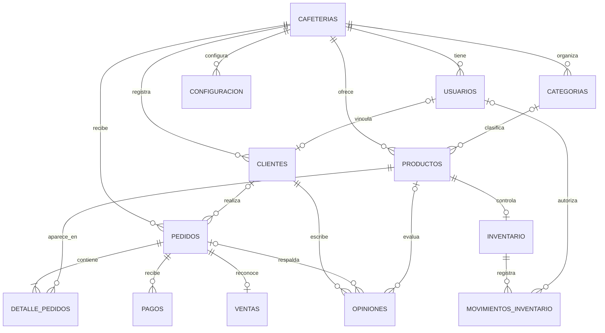

# Base de datos

## Requisitos y aplicacion

Motor objetivo: MySQL 8.0.16 o posterior, por soporte de restricciones `CHECK`
enforced. Crear la base de datos y el usuario de minimo privilegio mediante el
proveedor o el entorno local; la migracion no crea bases ni usuarios.

Aplicar el esquema inicial, seleccionando primero la base de datos:

```sh
mysql --default-character-set=utf8mb4 -u cafe_web -p cafe_web < database/migrations/001_initial_schema.sql
```

La migracion es el origen versionado del esquema inicial. En siguientes fases
se agregaran migraciones incrementales sin reescribir esta.

Para poblar el entorno local con el catalogo de demostracion:

```powershell
Get-Content -Raw .\database\seeds\001_demo_catalog.sql | mysql --default-character-set=utf8mb4 -u cafe_web -p cafe_web
```

Este seed es idempotente para la cafeteria `cafe-demo` y no debe ejecutarse en
produccion.

## Modelo entidad-relacion



Todas las referencias entre entidades de negocio incluyen `cafeteria_id` en
la clave foranea. Esto impide que una fila de un tenant apunte por error a una
fila de otro tenant, incluso ante errores de la API.

## Decisiones y trade-offs

- **Tenancy por cafeteria:** FKs compuestas aportan aislamiento referencial;
	hacen las consultas y relaciones mas verbosas. La API aun debe autorizar cada
	solicitud y filtrar por el tenant autenticado.
- **Un usuario pertenece a una cafeteria:** simplifica roles, sesiones y
	permisos iniciales. Usuarios que trabajen en varias sucursales requeriran una
	tabla de membresias y un contexto de sucursal en una migracion posterior.
- **Precio y nombre historicos en `detalle_pedidos`:** conserva el recibo aunque
	cambie el catalogo; repite datos deliberadamente para preservar historia.
- **Saldo mas ledger de inventario:** `inventario.existencias` permite lecturas
	rapidas y `movimientos_inventario` conserva auditoria. Actualizar ambos exige
	una transaccion y bloqueo de fila en la API.
- **`ventas` uno-a-uno con pedido:** simplifica metricas y evita contabilizar
	intentos de pago. La API debe crear/actualizar la venta de forma idempotente
	al confirmar el cobro y reflejar reembolsos.
- **Moneda por cafeteria y copia en pedido/pago/venta:** permite cambiar la
	configuracion sin reinterpretar importes historicos. No se fija una moneda
	por defecto porque depende del pais de operacion.

La base restringe estados, roles, importes, calificaciones y pertenencia al
tenant. Reglas que dependen de varias filas (por ejemplo, comprobar que un
producto estaba disponible al confirmar el pedido) pertenecen a servicios
transaccionales del backend, no a `CHECK` simples.